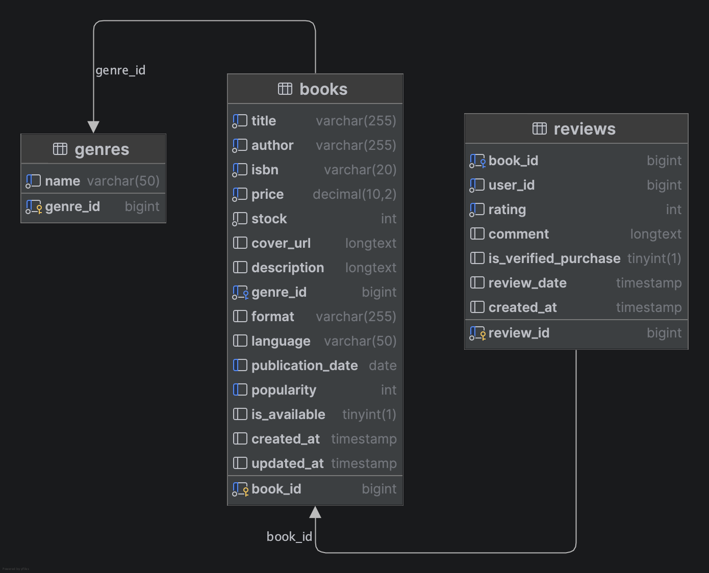
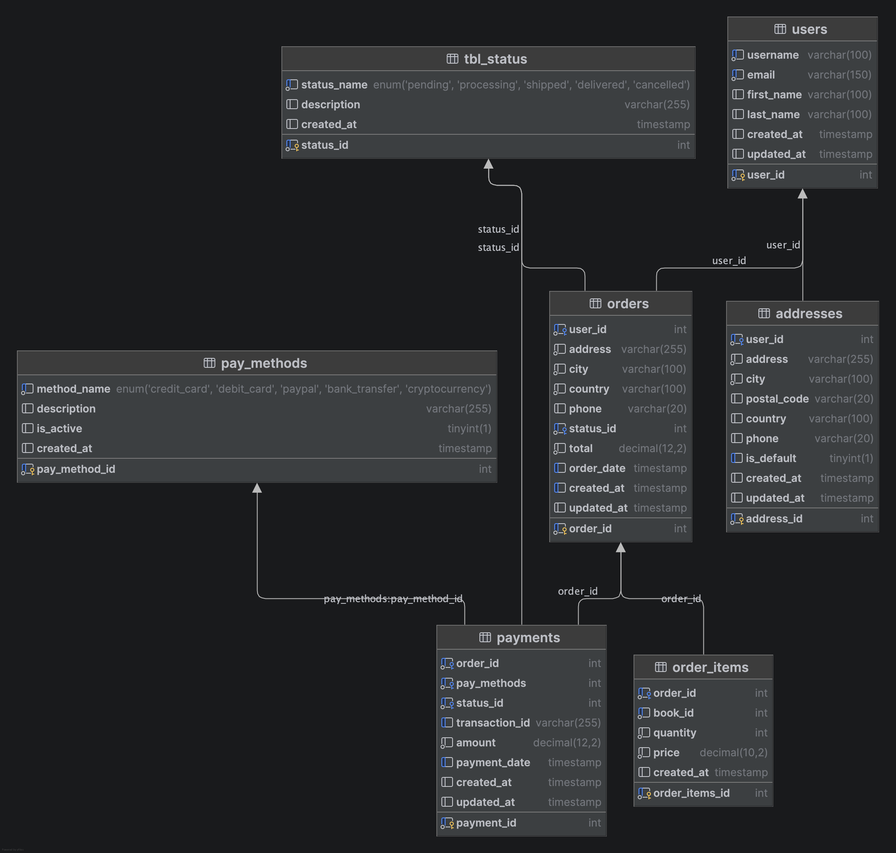

# 📚 Relatos de Papel - E-Commerce de Libros

Proyecto del Máster Universitario en Ingeniería de Software y Sistemas Informáticos (UNIR) - Grupo 18.

Esta versión está pensada para **desplegarse en AWS**: toda la aplicación es **un solo compilado** (un único JAR de Spring Boot que incluye la API y el front React) y usa **una sola base de datos MySQL** con todas las tablas.

## 🚀 Stack

| Capa | Tecnología |
|------|------------|
| Front | React 19, Vite, React Router, Bootstrap (carpeta `frontend/`) |
| Back | Java 21, Spring Boot 4.0.6, Spring Data JPA, Flyway |
| BD | MySQL 8.0 (Docker en local, **Amazon RDS MySQL** en AWS) |
| Build | Maven (`./mvnw`), con `frontend-maven-plugin` que compila el front dentro de `mvn package` |

## 📁 Estructura

```text
relatos-papel/
├── pom.xml                         # build único: compila front + back en un JAR
├── mvnw, mvnw.cmd, .mvn/           # Maven Wrapper (no hace falta instalar Maven)
├── docker-compose.yml              # MySQL local (BD relatos_papel, puerto 3307)
├── src/main/java/com/relatos_papel/
│   ├── RelatosPapelApplication.java
│   ├── config/                     # SpaController (rutas del front) y CorsConfig (solo desarrollo)
│   ├── catalogue/                  # libros y géneros        → /api/books
│   ├── orders/                     # pedidos                 → /api/orders
│   └── users/                      # usuarios y login        → /api/users
├── src/main/resources/
│   ├── application.yml             # configuración por variables de entorno (DB_HOST, DB_PORT, ...)
│   └── db/migration/               # V1__schema.sql, V2__seed_data.sql (Flyway)
├── frontend/                       # React + Vite (se compila dentro del JAR)
├── deploy/user-data-init.txt       # User data para la EC2 de AWS
└── docs/
    ├── AWS-paso-a-paso.md          # guía completa de la Actividad 2
    └── Backend - Relatos Papel.postman_collection.json
```

## 🗄️ Base de datos única (`relatos_papel`)

Tablas: `users`, `genres`, `books`, `tbl_status`, `pay_methods`, `addresses`, `orders`, `order_items`, `payments`.




Las tablas y los datos de ejemplo los crea **Flyway** al arrancar (solo la primera vez; registra lo ejecutado en `flyway_schema_history`). Las entidades JPA se validan contra el esquema (`ddl-auto: validate`).

## ⚙️ Configuración (variables de entorno)

La aplicación no tiene el host ni el puerto de la BD escritos en código; todo sale de variables (`application.yml`):

| Variable | Local (por defecto) | AWS (EC2 → RDS) |
|----------|---------------------|-----------------|
| `DB_HOST` | `localhost` | endpoint de RDS (`xxx.rds.amazonaws.com`) |
| `DB_PORT` | `3307` (mapeo de Docker) | `3306` (puerto nativo de MySQL en RDS) |
| `DB_NAME` | `relatos_papel` | `relatos_papel` |
| `DB_USER` / `DB_PASSWORD` | `root` / `mysql` | usuario maestro de RDS (`root` / ...) |
| `SERVER_PORT` | `8080` | `80` |

## ▶️ Levantar todo en local

Requisitos: **JDK 21 o superior** (sirve el 25), **Docker**, Postman.

### 1. Base de datos

```bash
docker compose up -d
docker compose ps          # esperar a "healthy"
```

### 2. Compilar (front + back en un solo JAR) y ejecutar

```bash
./mvnw clean package -DskipTests
java -jar target/relatos-papel-1.0.0.jar
```

Abre **http://localhost:8080**: sale el front y se comunica con la API y la BD. En el primer arranque se ven en el log las migraciones de Flyway.

> El primer build tarda unos minutos (descarga Node, `npm install`, `vite build` y las dependencias de Maven).

### 3. Alternativa: desarrollo desde IntelliJ

1. `File → Open…` y selecciona el `pom.xml` de la raíz (*Open as Project*). SDK 21+ y *Annotation Processing* activado (Lombok).
2. Ejecuta la clase `RelatosPapelApplication` (API en `http://localhost:8080`).
3. Para trabajar el front:
   ```bash
   cd frontend
   npm install
   npm run dev              # http://localhost:5173 (Vite reenvía /api a :8080)
   ```
4. Si ejecutas desde IntelliJ sin haber compilado el front, `http://localhost:8080` solo mostrará la API; usa `npm run dev` o ejecuta antes `./mvnw process-resources`.

Si necesitas apuntar a otra BD desde IntelliJ: *Run → Edit Configurations → Environment variables* → `DB_HOST=...;DB_PORT=...;DB_USER=...;DB_PASSWORD=...`.

### 4. Probar con Postman

Importa `docs/Backend - Relatos Papel.postman_collection.json` (variable `baseUrl = http://localhost:8080`; en AWS cámbiala a `http://<IP-pública-EC2>`).

```bash
curl http://localhost:8080/api/books
curl -X POST http://localhost:8080/api/users/login -H 'Content-Type: application/json' \
     -d '{"username":"techstore@unir.net","password":"123456"}'
```

### 5. Base de datos desde DataGrip / IntelliJ

Conexión MySQL: host `localhost`, puerto `3307`, usuario `root`, contraseña `mysql`, base `relatos_papel`

## 🌐 API

| Módulo | Rutas |
|--------|-------|
| Catalogue | `GET/POST /api/books`, `GET/PUT/PATCH/DELETE /api/books/{id}`, `POST /api/books/{id}/stock/decrease` |
| Orders | `POST /api/orders`, `GET /api/orders/{id}`, `GET /api/orders/user/{userId}` |
| Users | `POST /api/users/login`, `GET/POST /api/users`, `GET/PUT/PATCH/DELETE /api/users/{id}`, `GET /api/users/cif/{cif}` |

Login: `POST /api/users/login` con `{"username": "<correo>", "password": "<contraseña o su MD5>"}` → perfil del usuario (`401` si no coincide). El front envía la contraseña en MD5 (`crypto-js`); también se acepta en texto plano (Postman/curl).

## 👥 Integrantes

- Julieth Camila Mogollón Bernal
